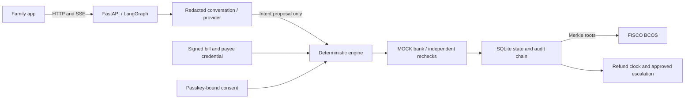

# Technical guide

Minh must pay his daughter Linh's Korean tuition before he knows her visa result. BursarBridge helps the family pay a vouched-for account and, if the visa is refused, follow the money back. The demo uses fictional Hanbit University and Lotus Home Bank MOCK. Its bank movements are simulated; the signatures, policy checks and full-stack chain receipts are real.

## One request, from chat to receipt

The [agent](../../services/api/bursarbridge/agent.py) sends progress before calling a hosted model. It interprets the request, asks one question if scope is ambiguous, or records missing prerequisites as a neutral `needs` card. Documents and a parent's signed mandate resume a pending request in its original student's thread. Responses follow the spoken language in Vietnamese, Korean, Chinese or English.

The [provider adapter](../../services/api/bursarbridge/providers.py) sees redacted conversation and stable, allowlisted [family facts](../../services/api/bursarbridge/reference.py), including the bill, schedule and refund policy. Its planner schema permits intent, scope and clarification only. It has no bank tools or credentials. Financial values in its prose are server-resolved placeholders; unsafe literal values or malformed output trigger scripted fallback. A model failure or exhausted budget degrades conversation without freezing money. The engine retains every payment check.

The [engine](../../services/api/bursarbridge/engine.py) derives the actual action from issuer credentials, mandates and bank records. It prepares a hash-bound approval. On approval, the MOCK bank checks authority again and consumes a single-use grant before debiting. A payment remains `sent` during its 30 simulated minute hold, then becomes delivered/matched as the judge advances the clock. Repeating a request cannot debit the same invoice scope twice.

## The seven core algorithms

| Algorithm | What it does; where to check it |
|---|---|
| Governance envelope and ordered policy | [policy.py](../../services/api/bursarbridge/policy.py) evaluates identity, hard denials, freeze/chain readiness, mandate, payee, provenance, finite amount/caps, remaining invoice, structuring, documents, screening and scam risk. Results are `DENY`, `ESCALATE` or `AUTO_EXECUTE`; a proposed action cannot bypass the order. |
| Payee binding | [security.py](../../services/api/bursarbridge/security.py) verifies Ed25519 VC-JWTs using `did:key`. The bank binds the current credential, purpose and account/name record. Tuition requires the university issuer; rent requires the named landlord, bank name-check and matching synthetic lease. PDF/chat fields never establish a destination. |
| Consent binding and one-time execution | [auth.py](../../services/api/bursarbridge/auth.py) binds WebAuthn challenge to the SHA-256 digest of the canonical action. Role, origin/RP, user verification, challenge and replay checks precede a single-use bank grant. The bank re-derives monetary fields and checks expiry, quote and cap within a serialized ledger transaction. |
| Corridor rules and anti-structuring | [rules.yaml](../../services/api/bursarbridge/rules.yaml) versions rules and citations. CN→KR checks family/beneficiary/purpose over a rolling year against the modelled USD 50k allowance and split-payment pattern. Cancelling a held transfer reverses its reservation while preserving history. This ledger cannot see other banks. |
| Scam intervention | [policy.py](../../services/api/bursarbridge/policy.py) scores recorded authority/urgency/secrecy/safe-account features. High risk opens a persistent cooling case requiring co-sign and time; neither can authorize an unverified account. Follow-up questions stay in the existing incident. Tainted evidence applies to its action, not the whole conversation. |
| Refusal and recovery | [refund_policy.py](../../services/api/bursarbridge/refund_policy.py) derives the claim from paid tuition and the original payer's bank record. The engine requires the student's form consent, tracks the promise, reconciles receipt and prepares approved chasers. A refusal before payment stops the pending tuition request without opening a claim. |
| Tamper-evident evidence | [store.py](../../services/api/bursarbridge/store.py) hashes each audit entry with its predecessor. [chain.py](../../services/api/bursarbridge/chain.py) anchors Merkle roots and sequence ranges on FISCO. [verify_audit.py](../../services/api/scripts/verify_audit.py) independently recomputes hashes/roots and checks receipts. T16 changes an entry, locates the first bad sequence, then restores it. |

## What the family's bill means

The signed invoice is `tuition-2027-v8`: **7,174,000 KRW tuition**, with two 3,587,000 KRW instalments. The seed's simulated today is 12 January 2027, noon in Korea. Acceptance is 15 December, the admission certificate is issued 22 December, and the D-2 application is filed 4 January. Payment takes place while that application is pending. Signed payment windows are 11-15 January and 11-15 February, closing at 17:00 Korean time. The bank independently enforces the relevant window. See [catalog.py](../../services/api/bursarbridge/catalog.py).

The separate dormitory notice is 1,500,000 KRW per semester. The dormitory office collects it; unused fees follow that office's own rule, with no verified entitlement or date in this demo. NHIS is external and billed after arrival; 70,000 KRW/month is a MOCK planning assumption. Neither belongs to the tuition transfer or refund. Private rent at 900,000 KRW/month is an alternative to the dorm, under its own parent-signed monthly mandate.

Hanbit's **fictional `HBU-REF-01-v3` contract** returns paid tuition for a refusal claim before classes start. Classes start 2 March; the promise is 16 March, two weeks later. No admission fee is charged on this invoice. After-start degree refunds require manual assessment; no language-institute day table is presented as a degree rule. The student signs withdrawal/refund forms with denial evidence. The destination is Dad's original bank-held account and SWIFT, never an account in a letter or chat.

The API supplies the expected return and final reconciliation. The MOCK return wire models 2% conversion loss and a 375,000 VND intermediary fee; the original 25,000 VND outward bank fee is not recovered. These are simulation assumptions, not Korean university charges. VND/KRW uses a labelled MOCK board rate; supported reference pairs use the attributed ECB/Frankfurter snapshot. A missed promise creates a dated international-office chaser for student approval, then a manual e-People/Ministry of Education complaint pack after further delay. Nothing is sent to a real office.

## Freeze, outages and concurrency

Freeze cancels outgoing payments still in the bank hold, returns their full debit and releases their cap reservation. It pauses outgoing approvals and temporarily suspends signed mandates. Incoming refunds, student claim consent and recovery correspondence continue. Parent-authorized Unfreeze restores the original valid signed limits; it does not revive expired/revoked authority or resend cancelled transfers. A cancelled rent month is not replayed by the clock. [Round 10 regressions](../../services/api/tests/test_round10.py) and T13/T15 check these distinctions.

SQLite transactions serialize a single API worker's ledger decisions. Hosted calls run outside the ledger lock. Background registration/anchoring uses generation and audit-prefix checks so delayed receipts cannot attach to a reset sandbox. Chain failure queues anchoring retries and keeps conversation available; outgoing money remains closed until the required chain state is available. Some synchronous payment chain operations can still delay a request. This is not a distributed bank settlement design.

## What the chain proves

The full stack runs four FISCO BCOS 3.17.1 Air nodes on one team-operated host. [AuditAnchor](../../contracts/AuditAnchor.sol) records commitments; [CredentialRegistry](../../contracts/CredentialRegistry.sol) records credential status. Only hashes, ranges and status records go on chain. No personal documents, real account credentials, money or tokens do.

[MandateGuard](../../contracts/MandateGuard.sol) is compiled and deployed but is not invoked by the bank execution path. Spending caps are enforced in Python/SQLite; a mandate's `chainTx` proves its audit commitment. Anchoring detects later changes to recorded data, not dishonesty in the MOCK source. A single host and team-controlled validators are not independent fault domains.

## Run and inspect

Start with the [keyless and full local instructions](../deploy/local.md). The [API runbook](../../services/api/README.md) covers health, timers and recovery. `make judge` runs T01-T20 with fixed seed 42 and scripted dialogue; `make judge-offline` needs no native services. The [evidence index](../../evidence/README.md) links sandbox logs, actual transaction hashes and verification commands. Permission details and residual risks are in the [security assessment](security.md).
